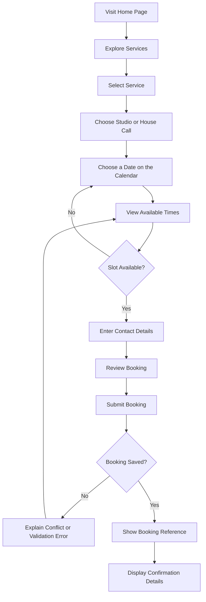

# Product Architecture — Nail Appointment Booking System

## 1. Product Overview

The Nail Appointment Booking System is a web platform that allows customers to discover a nail studio's services, explore nail designs, check appointment availability, and book services online.

The system will also provide an administrative interface for managing appointments, services, staff, working hours, and gallery content.

The product should be simple enough for a customer to use on a mobile phone without assistance, while giving the studio an efficient way to manage its daily operations.

### Product vision

Make booking a nail appointment convenient, transparent, and reliable for both customers and the studio.

### Product goals

- Allow customers to book appointments online at any time.
- Present services, prices, durations, and designs clearly.
- Reduce appointment conflicts and manual scheduling work.
- Give staff and administrators an organized view of bookings.
- Provide a responsive, visually appealing experience.
- Establish a foundation for future payments, notifications, and customer loyalty features.

---

## 2. Target Users

### 2.1 Customers

Customers want to:

- Discover the studio and its services.
- Compare prices and appointment durations.
- View examples of nail designs.
- Find an available appointment.
- Book without unnecessary steps.
- Receive confirmation of their booking.
- Retrieve a booking from its manage link, or with its reference and phone.
- Reschedule or cancel their appointment according to studio policy.
- See an in-app notice when the booking is confirmed, moved, cancelled by Chao, completed, or marked as a no-show.

### 2.2 Studio administrator

The administrator wants to:

- View upcoming appointments.
- Create, edit, activate, or deactivate services.
- Set service prices and durations.
- Manage staff and service assignments.
- Configure staff working hours and time off.
- Update gallery images.
- Confirm, complete, mark as no-show, or cancel appointments. Moving a time is customer-only.
- Close or reopen a day on the calendar.
- Read in-app notices when a booking is created, cancelled, or moved.
- Review booking history and basic operational information.

### 2.3 Nail technician or staff member

A staff member may need to:

- View their own schedule.
- See appointment times and relevant service details.
- Check customer notes necessary to provide the service.
- Identify unavailable periods.

Staff-specific access can be introduced after the initial administrator workflow is working.

---

## 3. Product Scope

### MVP — Initial release

The MVP should include:

1. Public landing page.
2. Service catalog.
3. Service details, pricing, and duration.
4. Nail design gallery.
5. Appointment availability search.
6. Booking creation.
7. Booking reference and confirmation screen.
8. Booking retrieval through a secure lookup process.
9. Booking cancellation according to studio policy.
10. Admin authentication.
11. Admin booking dashboard.
12. Service management.
13. Staff management.
14. Working-hour and time-off management.
15. Basic gallery management.
16. Responsive design and essential accessibility.
17. Reliable prevention of overlapping bookings.

### Post-MVP

The following should not block the initial release:

- M-Pesa integration.
- Online deposits and full payments.
- Automated SMS and email reminders.
- Customer accounts and booking history.
- Loyalty points and referrals.
- Coupons and promotions.
- Multiple studio branches.
- Advanced reporting.
- Staff-specific dashboards.
- Native mobile application.
- Automated review requests.

---

## 4. Customer Journey

### Primary booking journey

There is a single technician, Chao (see `BUSINESS_RULES.md`). Customers do not choose a technician. The API assigns her automatically. The `staff` model already exists, so a choice can be added once the studio grows. The review step is part of the form. The confirmation screen appears after the booking is saved.

### Journey requirements

- Customers must understand the service price before submitting a booking.
- Service duration must be visible.
- Customers must not be shown unavailable appointment times as bookable.
- Customer details should be collected only when needed.
- The booking form should preserve entered details when validation fails, where safe.
- Successful bookings must display a clear reference and appointment summary.
- If a slot becomes unavailable during submission, the customer must receive a clear explanation and be able to select another slot.
- The interface must work on small screens.

---

## 5. Main Product Modules

### 5.1 Public website

Purpose: introduce the studio and guide visitors toward booking.

Features:

- Studio name and branding.
- Hero section with a clear booking call to action.
- Short studio introduction.
- Active service catalog.
- Published gallery images, in a section on the home page. The section stays hidden when nothing is published.
- A Visit section with opening hours, Juja (the apartment name stays private), phone, WhatsApp, and email.
- Footer links to manage a booking and to admin sign-in.

The 24-hour cancel and reschedule policy is shown on the booking review step, the confirmation screen, and the manage page.

Acceptance criteria:

- Visitors can find the booking action without searching through multiple pages.
- Content is readable on mobile and desktop.
- Links and calls to action work correctly.
- Images have suitable alternative text where appropriate.
- The page communicates the studio's identity without making unsupported claims.

### 5.2 Service catalog

Purpose: help customers understand what they can book.

Each service should support:

- Name.
- Description.
- Price.
- Currency.
- Estimated duration.
- Category (`nails` or `makeup`).
- Active or inactive status.

Service images are not part of the current catalog. The `image_key` column exists and is unused.

Acceptance criteria:

- Only active services appear in public booking flows.
- Prices and durations are clearly displayed.
- An inactive service cannot be booked.
- Existing appointments retain their original service details even when the catalog changes.

### 5.3 Nail design gallery

Purpose: display the studio's work and inspire customers. The gallery is a section on the home page, not a separate page.

Features:

- Responsive image grid.
- Optional image titles and descriptions.
- Ordered images.
- Administrative image management. New uploads stay unpublished.

Acceptance criteria:

- Only published images appear publicly.
- Image uploads are restricted by file type and size. The admin form shrinks the longest side to 1600 pixels before upload when that makes a smaller file.
- Images load efficiently on mobile.
- Removing an image from the gallery does not unintentionally delete an appointment record.

### 5.4 Availability and scheduling

Purpose: show appointment times that can genuinely be booked.

The availability calculation must consider:

- Service duration.
- Staff eligibility.
- Staff working hours.
- Breaks and time off.
- Existing appointments.
- Booking lead time and future booking limits.
- Any required cleanup buffer.
- Studio timezone.

Acceptance criteria:

- Customers cannot book outside the studio's permitted scheduling window.
- Staff members cannot be assigned to conflicting appointments.
- A slot is available only if the entire service duration fits.
- Availability is recalculated during booking submission.
- Concurrent booking requests cannot successfully reserve the same staff member and time.
- The system handles a conflict gracefully and offers alternative slots.

### 5.5 Booking management

Purpose: create and manage appointments.

A booking should contain:

- Unique booking reference.
- Customer name and contact details.
- Selected service.
- Assigned staff member.
- Appointment date and time.
- Service duration and price snapshots.
- Booking status.
- Optional customer notes.
- Creation and update timestamps.

Acceptance criteria:

- Every successful booking receives a unique reference.
- Required customer fields are validated.
- A booking is not confirmed until its reservation has been committed successfully.
- Repeated form submissions do not unintentionally create duplicate bookings.
- Booking status changes follow defined rules.
- Customers can retrieve, reschedule, or cancel bookings only through the approved verification flow.

### 5.6 Admin dashboard

Purpose: provide a central location for managing studio operations.

Initial features:

- Summary of upcoming bookings.
- Booking list and date filters.
- Booking details.
- Booking status management: confirm, complete, no-show, or cancel. The administrator does not move the appointment time.
- Service management.
- Staff management.
- Schedule and time-off management.
- A calendar that closes or reopens one day by writing time off. A weekday with no hours stays closed until weekly hours change. Bookings already on that day stay.
- In-app notices for new, cancelled, and moved bookings.
- Gallery management.

Acceptance criteria:

- Only authorized administrators can access protected operations.
- Booking lists can be filtered by date and status.
- Administrative changes are validated.
- The interface communicates success, errors, and conflicts clearly.
- Important changes are recorded for audit purposes where appropriate.

---

## 6. Booking Rules and Business Logic

### Service rules

- Each service has a positive duration.
- Each active service has a valid price and currency.
- Inactive services cannot be selected for new bookings.
- Existing appointments retain their original service snapshots.

### Staff rules

- Staff members can be assigned only to services they perform.
- Inactive staff members cannot receive new appointments.
- Time off and working hours affect availability.
- Staff availability must be checked on the server.

### Appointment rules

- Appointment start time must be in the future, subject to studio policy.
- The full appointment duration must fit within the permitted working period.
- The system must prevent overlapping appointments for the same staff member.
- A cancellation must release the corresponding reservations.
- A customer may reschedule once, and only while both the current start and the new start are at least 24 hours away. The new time is validated before the existing reservation is replaced. An administrator does not reschedule.
- A cancelled appointment must not continue blocking availability.
- Administrative overrides must be explicit and audited.

### Guest booking rules

- Customers should be able to book without creating an account.
- The system collects only the contact information needed for the booking and confirmation process.
- A booking reference alone should not grant unrestricted access to private customer information.
- The manage link carries a token. A customer who has lost it can open the booking with the reference and the phone number on the booking. That check issues a new token and leaves the original link working.
- Sensitive booking-management operations require that token. Email and SMS are not used.

### Time and currency rules

- The default studio timezone is `Africa/Nairobi`.
- Appointment times are stored in a consistent UTC representation and displayed in the studio timezone.
- The default currency can be configured for the studio, with KES as the expected default for a Kenya-based business.
- Currency must be stored explicitly rather than assumed from a formatted price string.

---

## 7. Admin Permissions

### Initial roles

**Administrator**

- Manage services.
- Manage staff.
- Manage working hours and time off.
- View and manage bookings.
- Manage gallery content.
- Access operational information.

**Staff member** — optional future role

- View their own schedule.
- View relevant appointment details.
- Update permitted appointment statuses.
- No access to unrelated administrative settings unless explicitly granted.

**Customer**

- Browse public content.
- Create a booking.
- Retrieve or manage their own booking through the approved verification flow.
- No access to administrative endpoints.

Permissions must be enforced by the backend, not only by hiding buttons in the frontend.

---

## 8. User Experience and Design Principles

- Mobile-first layout.
- Clear navigation.
- Consistent typography and spacing.
- High-quality but optimized gallery images.
- Accessible color contrast.
- Visible focus states and keyboard support.
- Clear loading, empty, success, and error states.
- Minimal unnecessary steps in the booking flow.
- Readable date, time, duration, and price presentation.
- Confirmation screens that clearly summarize the appointment.
- Helpful messages when a selected slot is no longer available.

The visual direction should reflect the studio's brand. Use a polished beauty-studio aesthetic without sacrificing usability or accessibility.

---

## 9. Notifications

### MVP

The initial release can show an on-screen confirmation containing:

- Booking reference.
- Service, price, and duration.
- Date and time in Nairobi.
- Studio in Juja, or the house-call address. The apartment name stays off this screen.
- Customer name, phone, and optional email and notes.
- Instructions for cancellation or rescheduling. The technician is assigned by the server and is not shown here.

The manage page and the admin dashboard also show in-app notices. They are saved in the same database operation as the booking change, so a failed change does not leave a notice. A new booking and a customer cancellation notify Chao. A move notifies both. Chao confirming, cancelling, completing, or marking a no-show notifies the customer.

### Future notification capabilities

- The same booking events by email or SMS.
- Appointment reminders.

Notifications should be sent only after the relevant booking change has been committed successfully. Failed notifications must not silently undo a valid booking.

---

## 10. Payments

Payments are outside the initial MVP unless explicitly added to the project requirements.

Future payment functionality may include:

- M-Pesa deposits.
- Full payment.
- Payment status tracking.
- Refund tracking where supported.
- Payment-provider webhook processing.
- Idempotency protection against duplicate payment processing.

A booking must not be marked as paid based solely on a browser redirect or client-side success message. Payment status must be verified through the payment provider's trusted server-side response or webhook.

---

## 11. Product Success Metrics

Measure the product using metrics such as:

- Number of completed bookings.
- Percentage of visitors who start and complete the booking flow.
- Number of booking conflicts.
- Number of abandoned booking attempts.
- Cancellation and no-show rates.
- Time required to create a booking.
- Administrative time spent managing appointments.
- Email and SMS delivery success, once those providers are added. In-app notices are already stored with the booking change.

Avoid collecting unnecessary personal information just to produce analytics.

---

## 12. Risks and Mitigations

| Risk | Mitigation |
|---|---|
| Double booking | Atomic slot reservations or another tested concurrency-control mechanism |
| Customers abandon the form | Keep the flow short and show clear prices and durations |
| Unauthorized booking access | Use secure references and verified booking-management access |
| Invalid staff schedules | Validate schedules and time off on the server |
| Outdated service information | Store appointment snapshots |
| Notification failure | Separate notification delivery from booking persistence |
| Image storage costs | Optimize images and use R2 |
| Abuse or spam bookings | Apply rate limits and suitable anti-abuse measures |
| Production migration issues | Version and test D1 migrations |
| Unclear cancellation policy | Define and display the studio's policy before launch |

---

## 13. Release Acceptance Criteria

The initial product is ready for release when:

- Customers can browse active services and gallery images.
- Customers can find available appointment slots.
- Customers can create a booking without an account.
- A successful booking produces a unique reference and confirmation.
- The system reliably prevents conflicting reservations.
- Customers can access booking-management actions securely.
- Administrators can manage bookings, services, staff, and schedules.
- Admin endpoints are protected by server-side authorization.
- The interface is responsive and accessible for core tasks.
- D1 migrations and production configuration are documented.
- Tests cover booking creation, cancellation, conflicts, and authorization.
- A production smoke test verifies the deployed booking flow.
