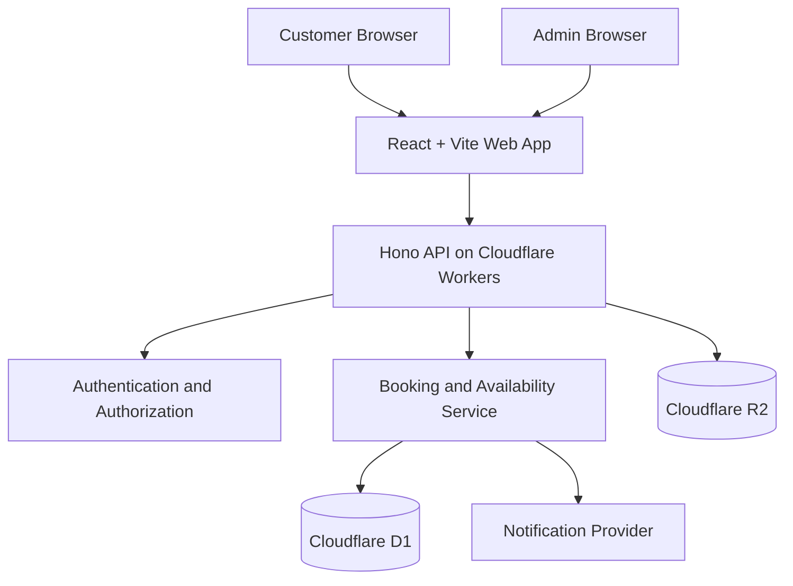

# Technical Architecture — Nail Appointment Booking System

## 1. Overview

This document defines the technical architecture for a nail studio appointment booking platform. The application will allow customers to explore services, view availability, and book appointments online. Studio administrators will manage services, staff, schedules, and bookings.

The system will be designed for local development first and deployment to Cloudflare when ready.

### Core principles

- Cloudflare-first architecture from the beginning.
- TypeScript across the frontend and backend.
- A modular monorepo that is easy to maintain.
- Secure, validated API endpoints.
- Reliable appointment scheduling with protection against double booking.
- Mobile-responsive customer experience.
- Simple local development and repeatable deployments.
- A clear separation between business logic, database access, and presentation.

---

## 2. Technology Stack

| Layer | Technology | Responsibility |
|---|---|---|
| Monorepo | pnpm workspaces + Turborepo | Manage applications and shared packages |
| Language | TypeScript | Frontend and backend development |
| Frontend | React + Vite | Customer and admin interfaces |
| Styling | Tailwind CSS | Responsive styling |
| UI components | shadcn/ui | Accessible, reusable interface components |
| Routing | React Router | Frontend navigation |
| Server state | TanStack Query | API fetching, caching, and mutations |
| API | Hono | HTTP routes and middleware |
| Runtime and hosting | Cloudflare Workers | Run the backend API |
| Database | Cloudflare D1 | Relational data storage using SQLite |
| Database access | Drizzle ORM + D1 adapter, or native D1 SQL | Typed queries and migrations |
| Validation | Zod | Validate request payloads and environment configuration |
| Image storage | Cloudflare R2 | Store service and gallery images |
| Deployment configuration | Wrangler | Local development, migrations, and Cloudflare deployment |
| Testing | Vitest | Unit and integration tests |
| Browser testing | Playwright | End-to-end booking flows |
| Code quality | Biome | Formatting and linting |
| Package management | pnpm | Dependency installation and workspace management |

### Database decision

Use **Cloudflare D1** as the production database, rather than PostgreSQL, so local development and deployment target the same database technology.

Use Drizzle with its supported D1 integration or native D1 prepared statements. Do not make the application dependent on PostgreSQL-specific features.

The database access layer must be designed around D1's actual SQLite behavior and transaction capabilities. Do not assume that every ORM transaction feature works identically on D1.

---

## 3. High-Level Architecture



### Request flow

1. A customer opens the public website.
2. The React application requests services and available appointment slots from the API.
3. Hono validates requests and executes the relevant business logic.
4. The API accesses D1 through the database layer.
5. A booking request is checked against current availability before being committed.
6. The API returns a booking reference and confirmation details.
7. Notifications can be sent through an external email or SMS provider when configured.

The browser must never connect directly to D1 or receive privileged Cloudflare credentials.

---

## 4. Monorepo Structure

```text
nail-booking/
├── apps/
│   ├── web/
│   │   ├── public/
│   │   ├── src/
│   │   │   ├── app/
│   │   │   ├── components/
│   │   │   ├── features/
│   │   │   │   ├── services/
│   │   │   │   ├── gallery/
│   │   │   │   ├── booking/
│   │   │   │   └── admin/
│   │   │   ├── hooks/
│   │   │   ├── lib/
│   │   │   ├── routes/
│   │   │   └── styles/
│   │   └── package.json
│   │
│   └── api/
│       ├── src/
│       │   ├── index.ts
│       │   ├── app.ts
│       │   ├── env.ts
│       │   ├── config/        # studio scheduling rules (studio.ts)
│       │   ├── middleware/
│       │   ├── routes/
│       │   ├── modules/
│       │   │   ├── auth/
│       │   │   ├── services/
│       │   │   ├── staff/
│       │   │   ├── availability/
│       │   │   ├── bookings/
│       │   │   ├── gallery/
│       │   │   └── admin/
│       │   ├── db/
│       │   │   ├── schema.ts
│       │   │   ├── client.ts
│       │   │   └── repositories/
│       │   └── utils/
│       ├── migrations/
│       ├── seed/          # local development data
│       ├── test/
│       ├── wrangler.jsonc
│       └── package.json
│
├── packages/
│   ├── types/
│   ├── validation/
│   ├── config/
│   └── ui/
│
├── docs/
│   ├── TECHNICAL_ARCHITECTURE.md
│   ├── PRODUCT_ARCHITECTURE.md
│   ├── BUSINESS_RULES.md
│   └── SPRINT.md
│
├── package.json
├── pnpm-workspace.yaml
├── turbo.json
├── tsconfig.base.json
├── biome.json
├── .gitignore
└── README.md
```

### Structure rules

- `apps/web` contains the frontend.
- `apps/api` contains the Hono API and Cloudflare Worker configuration.
- `packages/types` contains shared TypeScript types that do not expose database internals.
- `packages/validation` contains reusable Zod schemas where sharing is appropriate.
- `packages/config` contains shared development configuration.
- `packages/ui` contains reusable UI components if they need to be shared across applications.
- Database queries belong in the API's database/repository layer.
- Business rules must not be implemented exclusively inside React components.

Do not create empty packages just for the sake of the structure. Add them when there is a real need.

---

## 5. Cloudflare Configuration

### Cloudflare Workers

The Hono API will run as a Cloudflare Worker.

The Worker will receive configured bindings through its environment, including:

- `DB`: D1 database binding.
- `BUCKET`: R2 bucket binding, when image storage is implemented.
- Authentication secrets and other private environment variables.
- Optional notification-provider configuration.

Use Wrangler for local development, environment configuration, database migrations, and deployment.

### Cloudflare D1

D1 will store:

- Customer accounts, where accounts are enabled.
- Admin accounts or references to the chosen authentication system.
- Services and service pricing.
- Staff and service assignments.
- Staff working hours and time off.
- Appointments.
- Slot reservations or equivalent booking-conflict protection.
- Gallery metadata and image object keys.
- Audit events for important administrative changes.

Use version-controlled SQL migrations. Do not rely on manually editing a production database.

### Cloudflare R2

R2 will store uploaded images, including:

- Service images.
- Nail design gallery images.
- Studio photographs.
- Other approved public media.

Store object keys and related metadata in D1, not image binary data.

Public images can be served through an appropriately configured public domain or a controlled delivery endpoint. Private uploads must not be exposed through public URLs.

### Optional future services

- **Cloudflare Queues:** asynchronous notification processing or other background jobs.
- **Durable Objects:** serialize competing booking operations when required by the final booking design.
- **Email/SMS provider:** appointment confirmations and reminders.
- **Payment provider:** M-Pesa or another supported payment gateway.

These are optional extensions and should not block the first working version.

---

## 6. Database Design

The following entities form the initial logical data model. The source of truth for columns and constraints is `apps/api/src/db/schema.ts` and the migrations generated from it.

All instants (`*_at` columns) are stored as canonical UTC text in the form `YYYY-MM-DDTHH:MM:SS.SSSZ`, which is what `Date#toISOString` produces. CHECK constraints enforce this format. Because instants are compared and used as keys in text form, one consistent format is required for correctness.

### `users`

Stores customer identity and account information when customer accounts are enabled.

Suggested fields:

- `id`
- `name`
- `email`
- `phone`
- `created_at`
- `updated_at`

Normalize email addresses before lookup. Avoid requiring customers to create an account for the initial guest-booking flow.

### `admins`

Stores application-specific administrative roles or references to the selected authentication provider.

Suggested fields:

- `id`
- `user_id` or authentication subject
- `role`
- `created_at`

Public registration must never grant administrative privileges.

### `services`

Stores bookable services.

Suggested fields:

- `id`
- `slug` (unique)
- `name`
- `description`
- `category` (`nails` or `makeup`)
- `duration_minutes`
- `price_minor`
- `currency`
- `image_key` (R2 object key, optional)
- `is_active`
- `display_order`
- `created_at`
- `updated_at`

Store money as integer minor units, such as cents, rather than floating-point values. Keep the currency explicit.

### `staff`

Stores staff members who perform services.

Suggested fields:

- `id`
- `name`
- `bio`
- `is_active`
- `created_at`
- `updated_at`

### `staff_services`

Defines which services each staff member can perform.

Suggested fields:

- `staff_id`
- `service_id`

Use a composite primary key or unique constraint to prevent duplicate assignments.

### `staff_working_hours`

Defines recurring working hours.

Suggested fields:

- `id`
- `staff_id`
- `weekday`
- `start_time`
- `end_time`
- `effective_from`
- `effective_until`
- `is_active`

Support split shifts if the business requires them.

### `staff_time_off`

Stores leave, holidays, breaks, and other unavailable periods.

Suggested fields:

- `id`
- `staff_id`
- `start_at`
- `end_at`
- `reason`
- `created_at`

### `appointments`

Stores the booking record.

Suggested fields:

- `id`
- `booking_reference`
- `management_token_hash`: SHA-256 of the customer's booking-management token
- `idempotency_key`: unique and nullable, taken from the `Idempotency-Key` header
- `customer_id`, nullable for guest bookings (not added yet; there are no customer accounts in the MVP)
- `customer_name`
- `customer_email`, where provided
- `customer_phone`
- `staff_id`
- `service_id`
- `service_name_snapshot`
- `duration_minutes_snapshot`
- `price_minor_snapshot`
- `currency`
- `start_at`
- `end_at`
- `status`
- `location` (`studio` or `house_call`)
- `address` (required when `location` is `house_call`)
- `travel_fee_minor`
- `customer_notes`
- `created_at`
- `updated_at`

`start_at` and `end_at` cover the service only. Buffers are expressed in the slot reservations.

Snapshot fields preserve the service name, duration, and price that applied when the booking was made, even if the catalog changes later.

Possible statuses:

- `pending`
- `confirmed`
- `cancelled`
- `completed`
- `no_show`

Use a documented state-transition policy rather than allowing arbitrary status changes.

### `appointment_slot_reservations`

Use a slot-reservation table if the booking model uses fixed scheduling increments.

Suggested fields:

- `staff_id`
- `slot_start_at`
- `appointment_id`

Create a unique constraint on `(staff_id, slot_start_at)`.

A booking occupying multiple scheduling increments reserves every increment it needs. Reservation creation must be atomic so a partial reservation cannot be left behind if a conflict occurs.

The chosen increment is **15 minutes**. A CHECK constraint requires `slot_start_at` to be a canonical instant on a :00, :15, :30, or :45 boundary. A booking reserves the slots for its service duration plus its buffers:

- Studio bookings add the turnaround buffer after the service.
- House calls add the travel buffer before and after the service.

The values are defined in `apps/api/src/config/studio.ts` and documented in `BUSINESS_RULES.md`.

Reservations are removed by `ON DELETE CASCADE` only when the appointment row itself is deleted. Cancelling changes the status instead, so the cancellation operation must delete the appointment's reservations in the same atomic batch.

If fixed slot reservations are not appropriate for the business, use another explicitly concurrency-safe reservation strategy. Do not rely only on checking for overlapping appointments in application code before inserting a booking; concurrent requests can both pass that check.

### `gallery_images`

Stores gallery metadata.

Suggested fields:

- `id`
- `title`
- `description`
- `alt_text`
- `r2_object_key` (unique)
- `display_order`
- `is_published` (default false)
- `created_at`
- `updated_at`

### `audit_events`

Records important administrative operations. Not created yet: it is added in Sprint 6 together with the admin identity tables.

Suggested fields:

- `id`
- `actor_id`
- `action`
- `entity_type`
- `entity_id`
- `created_at`

Avoid recording passwords, session tokens, payment secrets, or unnecessary customer data.

---

## 7. Booking and Availability Logic

Booking integrity is a critical system requirement.

### Availability calculation

Availability should be derived from:

1. The selected service duration.
2. The selected staff member's service eligibility.
3. Staff working hours for the requested date.
4. Time off, breaks, and studio closures.
5. Existing confirmed or pending bookings that block availability.
6. The studio's booking lead time and future booking horizon.
7. Any configured cleanup or turnaround buffer.
8. The selected timezone.

A slot is offered only if the complete service duration and required buffer fit within the staff member's available period.

### Creating a booking

The API should:

1. Validate the request.
2. Load the current service and its duration.
3. Verify that the service and staff member are active and compatible.
4. Recalculate the requested slot against current availability.
5. Atomically reserve the required scheduling increments or use the selected concurrency-control mechanism.
6. Create the appointment and its reservations as one logical operation.
7. Return a booking reference and booking details.
8. Trigger confirmation delivery after the booking has been committed.

If a slot is no longer available, return a clear conflict response and ask the customer to select another slot.

### Concurrency strategy

D1 uses SQLite semantics, so do not assume that a general-purpose PostgreSQL locking pattern will work.

For a fixed-increment booking model, unique slot-reservation constraints combined with an atomic, rollback-safe write operation can prevent two appointments from reserving the same staff/time slot.

Test the chosen D1 operation and failure behavior directly. If the required guarantees cannot be established for the chosen implementation, introduce a serialized booking coordinator, such as a Durable Object, before production launch.

The API must never confirm a booking before the reservation operation succeeds.

### Timezone

- Use `Africa/Nairobi` as the default studio timezone.
- Store appointment instants in a consistent UTC representation.
- Calculate working hours and display dates in the studio timezone.
- Validate date and time inputs on the server.
- Test dates around timezone and daylight-saving boundaries if the platform may later serve other regions.

---

## 8. API Design

Use a versioned REST API under `/api/v1`.

### Public endpoints

| Method | Endpoint | Purpose |
|---|---|---|
| GET | `/api/v1/services` | List active services |
| GET | `/api/v1/services/:id` | Get service details |
| GET | `/api/v1/staff` | List bookable staff |
| GET | `/api/v1/gallery` | List published gallery images |
| GET | `/api/v1/availability` | Find available slots |
| POST | `/api/v1/bookings` | Create a booking |
| GET | `/api/v1/bookings/:reference` | Retrieve a booking using an authorized lookup mechanism |
| POST | `/api/v1/bookings/:reference/cancel` | Request booking cancellation |

The booking lookup must not expose private appointment details based only on a predictable ID. Use an unguessable reference plus an appropriate verification mechanism, such as a secure management token or verified customer identity.

#### `GET /api/v1/availability`

| Query parameter | Rule |
|---|---|
| `serviceId` | Required. Must be an active service. |
| `date` | Required. A real `YYYY-MM-DD` date in the studio timezone, from today up to the maximum advance window. |
| `location` | `studio` (default) or `house_call`. House calls add travel buffers before and after the service. |

```json
{
  "data": {
    "serviceId": "svc_gel",
    "date": "2026-11-10",
    "location": "studio",
    "timezone": "Africa/Nairobi",
    "lastBookableDate": "2027-01-04",
    "slots": [{ "startAt": "2026-11-10T06:00:00.000Z", "endAt": "2026-11-10T07:00:00.000Z" }]
  }
}
```

- Slot times cover the service only, without buffers, and are UTC instants. Clients display them in `timezone`.
- A time is listed if any eligible active staff member is free. Staff are not exposed, and booking creation picks the staff member.
- Errors:
  - `400 validation_error` for malformed parameters.
  - `400 date_out_of_range` for dates outside the booking window.
  - `404 service_not_found` for unknown or inactive services.
- Implementation: `apps/api/src/modules/availability/`. The pure engine (`availability.engine.ts`) also exports `reservationSlots`. Booking creation must use that same function when it writes reservation rows, so availability and conflict locking agree.

### Admin endpoints

| Method | Endpoint | Purpose |
|---|---|---|
| GET | `/api/v1/admin/bookings` | List bookings with filters |
| PATCH | `/api/v1/admin/bookings/:id` | Update permitted booking details |
| GET | `/api/v1/admin/services` | Manage service catalog |
| POST | `/api/v1/admin/services` | Create a service |
| PATCH | `/api/v1/admin/services/:id` | Update a service |
| GET | `/api/v1/admin/staff` | Manage staff |
| POST | `/api/v1/admin/staff` | Create a staff member |
| PATCH | `/api/v1/admin/staff/:id` | Update a staff member |
| GET | `/api/v1/admin/schedules` | View schedules |
| POST | `/api/v1/admin/time-off` | Add staff unavailability |
| GET | `/api/v1/admin/gallery` | Manage gallery images |
| POST | `/api/v1/admin/gallery` | Add gallery metadata or initiate an upload |

Implement only endpoints needed by the current sprint. This table is the planned API surface, not a requirement to build everything immediately.

### API conventions

- Validate request bodies, query parameters, and path parameters.
- Use consistent JSON response shapes.
- Return appropriate HTTP status codes.
- Never return stack traces or secrets to the client.
- Apply pagination to growing admin lists.
- Add rate limits and anti-abuse controls to public booking endpoints.
- Use idempotency protection where repeated submissions could create duplicate bookings.
- Keep API errors useful to customers but free of sensitive internals.

---

## 9. Authentication and Authorization

Use a maintained authentication solution only after verifying that it supports the selected Cloudflare Workers and D1 deployment model.

Before selecting a library, verify:

- Compatibility with the current Workers runtime.
- Support for D1 or a compatible session-storage strategy.
- Secure session cookies and expiration.
- Password reset or another safe account-recovery mechanism if passwords are used.
- CSRF protections where applicable.
- Secure logout and session revocation.

For the MVP:

- Customer accounts are optional.
- Guest booking is supported.
- Admin access is restricted.
- Every admin endpoint enforces authorization server-side.
- Public registration cannot create admin users.
- Sensitive admin changes are audited.

Do not store plaintext passwords or invent a custom authentication protocol.

---

## 10. Security Requirements

- Keep secrets in Cloudflare secrets or environment-specific secret management, never in source control.
- Validate and normalize user input.
- Use parameterized database queries.
- Configure CORS for the intended frontend origins.
- Apply rate limits to booking, cancellation, authentication, and other abuse-prone endpoints.
- Prevent unauthorized access to customer records.
- Protect administrative routes with server-side authorization.
- Validate uploaded file type and size.
- Do not trust file extensions alone.
- Restrict R2 upload permissions and object access.
- Avoid exposing private object keys or credentials.
- Use secure session cookies where applicable.
- Add anti-spam protection where needed.
- Keep logs free of credentials and unnecessary personal data.
- Use environment-specific configuration for development, staging, and production.
- Review dependencies and update them regularly.

---

## 11. Testing Strategy

### Unit tests

Test:

- Service duration and buffer calculations.
- Working-hour validation.
- Availability generation.
- Booking status transitions.
- Price and duration snapshots.
- Input validation.
- Authorization rules.

### Database and integration tests

Test:

- D1 schema and migrations.
- Booking creation and cancellation.
- Slot reservation creation and rollback.
- Repeated booking submissions.
- Two simultaneous requests for the same slot.
- Requests for overlapping appointments.
- Staff time-off conflicts.
- Service changes after a booking has been created.
- Invalid and expired booking-management tokens.

Use a D1-compatible local or test environment. A passing mock-only test is not enough to prove production booking integrity.

### End-to-end tests

Use Playwright to test:

1. Browse services.
2. Select a service.
3. Select a staff member, where applicable.
4. Choose a date and available time.
5. Enter customer details.
6. Submit the booking.
7. Receive a booking reference.
8. View or cancel a booking using the intended verification flow.
9. Log in as an administrator.
10. Manage bookings, services, staff, and schedules.

---

## 12. Development and Deployment Workflow

### Local development

1. Install the supported Node.js version and pnpm.
2. Install dependencies from the repository root.
3. Configure Wrangler for local Worker development.
4. Create a local D1 database configuration.
5. Apply database migrations.
6. Start the API using Wrangler's local development workflow.
7. Start the Vite frontend.
8. Test frontend-to-API communication.
9. Run automated tests before committing changes.

The local environment should exercise the same D1-oriented data model used in production.

### Deployment

1. Create the Cloudflare D1 database.
2. Create the R2 bucket when image storage is implemented.
3. Configure Worker bindings and environment variables.
4. Add required secrets through Cloudflare's secret-management mechanism.
5. Apply production D1 migrations.
6. Build and deploy the Hono Worker.
7. Build and deploy the frontend using the chosen Cloudflare-compatible static hosting option.
8. Configure production domains and frontend API URLs.
9. Verify CORS, authentication, database access, and image delivery.
10. Run production smoke tests, especially booking-conflict tests.

Do not deploy unreviewed migrations or rely on local database contents in production.

---

## 13. Future Extensions

Potential later improvements include:

- M-Pesa or card payments.
- Email and SMS confirmations.
- Automated reminders.
- Customer accounts and booking history.
- Loyalty and referral programs.
- Discount codes.
- Staff-specific calendars.
- Multi-branch support.
- Analytics and revenue reporting.
- Cloudflare Queues for background processing.
- Durable Objects for serialized booking operations where required.
- A React Native/Expo mobile application.

These features should be introduced only when the core booking workflow is stable.

---

## 14. Definition of Technical Readiness

The application is technically ready for its initial release when:

- The frontend and API run locally.
- The API uses D1-compatible queries and migrations.
- Development and production configuration are separated.
- Admin authorization is enforced server-side.
- Customers can create valid bookings.
- Competing booking requests cannot create overlapping reservations for the same staff member.
- Booking references cannot be used to expose unauthorized customer information.
- Automated tests cover the core scheduling rules.
- The production deployment and smoke-test procedure is documented.
