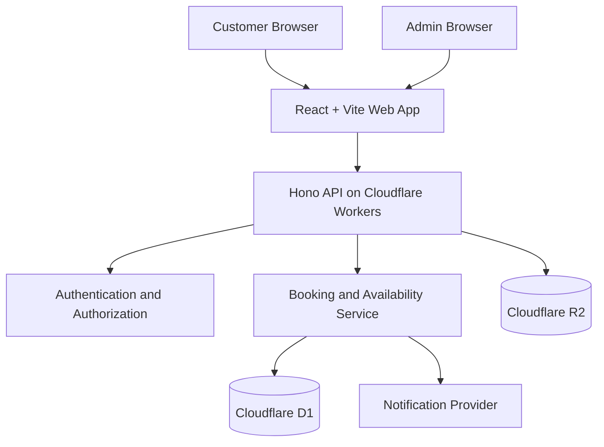

# Technical Architecture — Nail Appointment Booking System

## 1. Overview

This document defines the technical architecture for a nail studio appointment booking platform. The application will allow customers to explore services, view availability, and book appointments online. Studio administrators will manage services, staff, schedules, and bookings.

The system will be designed for local development first and deployment to Cloudflare when ready.

### Core principles

- Cloudflare-first architecture from the beginning.
- TypeScript across the frontend and backend.
- A modular monorepo that is easy to maintain.
- Secure, validated API endpoints.
- Reliable appointment scheduling with protection against double booking.
- Mobile-responsive customer experience.
- Simple local development and repeatable deployments.
- A clear separation between business logic, database access, and presentation.

---

## 2. Technology Stack

| Layer | Technology | Responsibility |
|---|---|---|
| Monorepo | pnpm workspaces + Turborepo | Manage applications and shared packages |
| Language | TypeScript | Frontend and backend development |
| Frontend | React + Vite | Customer and admin interfaces |
| Styling | Tailwind CSS | Responsive styling. Screens are custom components. `apps/web/components.json` is present, and no shadcn/ui components are installed |
| Routing | React Router | Frontend navigation |
| Server state | TanStack Query | API fetching, caching, and mutations |
| API | Hono | HTTP routes and middleware |
| Runtime and hosting | Cloudflare Workers | Run the backend API |
| Database | Cloudflare D1 | Relational data storage using SQLite |
| Database access | Drizzle ORM + D1 adapter | Typed queries and migrations |
| Validation | Zod | Validate request payloads and environment configuration |
| Image storage | Cloudflare R2 | Gallery images. `services.image_key` is unused |
| Deployment configuration | Wrangler | Local development, migrations, and Cloudflare deployment |
| Testing | Vitest | Unit and integration tests |
| Browser testing | Playwright (planned) | End-to-end booking flows. Not installed. Sprint 8 |
| Code quality | Biome | Formatting and linting |
| Package management | pnpm | Dependency installation and workspace management |

### Database decision

Use **Cloudflare D1** as the production database, rather than PostgreSQL, so local development and deployment target the same database technology.

Drizzle is the database access layer, through its D1 integration. Do not make the application dependent on PostgreSQL-specific features.

The database access layer must be designed around D1's actual SQLite behavior and transaction capabilities. Do not assume that every ORM transaction feature works identically on D1.

---

## 3. High-Level Architecture



### Request flow

1. A customer opens the public website.
2. The React application requests services and available appointment slots from the API.
3. Hono validates requests and executes the relevant business logic.
4. The API accesses D1 through the database layer.
5. A booking request is checked against current availability before being committed.
6. The API returns a booking reference and confirmation details.
7. Notifications can be sent through an external email or SMS provider when configured.

The browser must never connect directly to D1 or receive privileged Cloudflare credentials.

---

## 4. Monorepo Structure

```text
nail-booking/
├── apps/
│   ├── web/
│   │   ├── src/
│   │   │   ├── app/           # router, query client
│   │   │   ├── components/
│   │   │   ├── features/
│   │   │   │   ├── services/
│   │   │   │   ├── gallery/
│   │   │   │   ├── booking/
│   │   │   │   └── admin/
│   │   │   ├── lib/
│   │   │   ├── routes/
│   │   │   └── styles/
│   │   ├── components.json    # shadcn config only; no components installed
│   │   └── package.json
│   │
│   └── api/
│       ├── src/
│       │   ├── index.ts
│       │   ├── app.ts
│       │   ├── env.ts
│       │   ├── config/        # studio scheduling rules (studio.ts)
│       │   ├── middleware/
│       │   ├── routes/        # health
│       │   ├── modules/
│       │   │   ├── auth/
│       │   │   ├── services/
│       │   │   ├── availability/
│       │   │   ├── bookings/
│       │   │   ├── gallery/
│       │   │   └── admin/     # bookings, services, staff, hours, time off, gallery
│       │   ├── db/
│       │   │   ├── schema.ts
│       │   │   └── client.ts
│       │   └── utils/
│       ├── migrations/
│       ├── seed/              # local development data
│       ├── scripts/
│       ├── test/
│       ├── wrangler.jsonc
│       └── package.json
│
├── packages/
│   └── types/                 # shared API contracts
│
├── docs/
│   ├── TECHNICAL_ARCHITECTURE.md
│   ├── PRODUCT_ARCHITECTURE.md
│   ├── BUSINESS_RULES.md
│   └── SPRINT.md
│
├── package.json
├── pnpm-workspace.yaml
├── turbo.json
├── tsconfig.base.json
├── biome.json
├── .gitignore
└── README.md
```

### Structure rules

- `apps/web` contains the frontend.
- `apps/api` contains the Hono API and Cloudflare Worker configuration.
- `packages/types` is the only shared package. It holds API contracts and does not expose database internals.
- Each module keeps its repository next to its routes (`*.repository.ts`). There is no `db/repositories` directory and no `modules/staff` directory. Staff, hours, and time off live under `modules/admin`.
- Business rules must not be implemented exclusively inside React components.

Do not create empty packages just for the sake of the structure. Add them when there is a real need.

### Frontend routes

Defined in `apps/web/src/app/router.tsx`.

| Path | Screen |
|---|---|
| `/` | Home: hero, service catalog, gallery section, visit details |
| `/book/:serviceId` | Booking: location, month calendar, times, details, review, then confirmation |
| `/manage` | Look up a booking |
| `/manage/:reference` | Manage a booking. The token arrives as `#token` |
| `/admin/login` | Administrator sign-in |
| `/admin` | Upcoming bookings |
| `/admin/bookings/:id` | Booking detail and status changes |
| `/admin/services` | Service catalog management |
| `/admin/staff` | Staff, service assignments, hours, and time off |
| `/admin/gallery` | Gallery uploads and publication |

Booking on `/book/:serviceId` is three steps: where and when (studio or house call, `DateCalendar`, time slots), contact details, then review. The confirmation screen appears after the booking is saved. The management token is returned once and kept in `sessionStorage` for that browser tab, and in the `#token` on `/manage/:reference`. Customers do not choose a technician. The API assigns an eligible active staff member.

---

## 5. Cloudflare Configuration

### Cloudflare Workers

The Hono API will run as a Cloudflare Worker.

The Worker will receive configured bindings through its environment, including:

- `DB`: D1 database binding.
- `BUCKET`: R2 bucket binding for gallery images.
- Authentication secrets and other private environment variables.
- Optional notification-provider configuration.

Use Wrangler for local development, environment configuration, database migrations, and deployment.

### Cloudflare D1

D1 will store:

- Customer accounts, where accounts are enabled.
- Admin accounts or references to the chosen authentication system.
- Services and service pricing.
- Staff and service assignments.
- Staff working hours and time off.
- Appointments.
- Slot reservations or equivalent booking-conflict protection.
- Gallery metadata and image object keys.
- Audit events for important administrative changes.

Use version-controlled SQL migrations. Do not rely on manually editing a production database.

### Cloudflare R2

R2 stores gallery images. The `services.image_key` column exists and is unused: the public service DTO has no image field, and admin service writes do not accept one. Studio photographs, when published, go through the gallery.

Store object keys and related metadata in D1, not image binary data.

Public images can be served through an appropriately configured public domain or a controlled delivery endpoint. Private uploads must not be exposed through public URLs.

### Optional future services

- **Cloudflare Queues:** asynchronous notification processing or other background jobs.
- **Durable Objects:** serialize competing booking operations when required by the final booking design.
- **Email/SMS provider:** appointment confirmations and reminders.
- **Payment provider:** M-Pesa or another supported payment gateway.

These are optional extensions and should not block the first working version.

---

## 6. Database Design

The following entities form the initial logical data model. The source of truth for columns and constraints is `apps/api/src/db/schema.ts` and the migrations generated from it.

Studio instants (`*_at` columns on appointments, hours, time off, gallery, and audit rows) are stored as canonical UTC text in the form `YYYY-MM-DDTHH:MM:SS.SSSZ`, which is what `Date#toISOString` produces. CHECK constraints enforce this format. Because instants are compared and used as keys in text form, one consistent format is required for correctness. Better Auth tables are the exception: their timestamps are integer epoch milliseconds.

### Authentication tables

Admin sign-in uses Better Auth on D1. Its Drizzle tables are `user`, `session`, `account`, `verification`, and `rate_limit`. Those timestamps are integer epoch milliseconds, which is what the library writes. Studio tables keep canonical UTC text.

Customer accounts are not enabled. Guest booking does not create a `user` row. Public HTTP sign-up is disabled, so this table is filled only by `pnpm admin:create`.

### `admins`

One row per administrator. A Better Auth session is not enough.

- `id`
- `user_id` (unique, foreign key to `user`, cascade on delete)
- `role` (`admin` only)
- `created_at`

Public registration must never grant administrative privileges. Staff logins are out of scope.

### `services`

Stores bookable services.

Suggested fields:

- `id`
- `slug` (unique)
- `name`
- `description`
- `category` (`nails` or `makeup`)
- `duration_minutes`
- `price_minor`
- `currency`
- `image_key` (optional R2 object key). Present on the table and unused by the API and the admin UI
- `is_active`
- `display_order`
- `created_at`
- `updated_at`

Store money as integer minor units, such as cents, rather than floating-point values. Keep the currency explicit.

### `staff`

Stores staff members who perform services.

Suggested fields:

- `id`
- `name`
- `bio`
- `is_active`
- `created_at`
- `updated_at`

### `staff_services`

Defines which services each staff member can perform.

Suggested fields:

- `staff_id`
- `service_id`

Use a composite primary key or unique constraint to prevent duplicate assignments.

### `staff_working_hours`

Defines recurring working hours.

Suggested fields:

- `id`
- `staff_id`
- `weekday`
- `start_time`
- `end_time`
- `effective_from`
- `effective_until`
- `is_active`

Support split shifts if the business requires them.

### `staff_time_off`

Stores leave, holidays, breaks, and other unavailable periods.

Suggested fields:

- `id`
- `staff_id`
- `start_at`
- `end_at`
- `reason`
- `created_at`

### `appointments`

Stores the booking record.

Suggested fields:

- `id`
- `booking_reference`
- `management_token_hash`: SHA-256 of the customer's booking-management token
- `idempotency_key`: unique and nullable, taken from the `Idempotency-Key` header
- `customer_id`, nullable for guest bookings (not added yet; there are no customer accounts in the MVP)
- `customer_name`
- `customer_email`, where provided
- `customer_phone`
- `staff_id`
- `service_id`
- `service_name_snapshot`
- `duration_minutes_snapshot`
- `price_minor_snapshot`
- `currency`
- `start_at`
- `end_at`
- `status`
- `location` (`studio` or `house_call`)
- `address` (required when `location` is `house_call`)
- `travel_fee_minor`
- `customer_notes`
- `rescheduled_at`: set when the customer moves the appointment. One move is allowed. Null until then.
- `created_at`
- `updated_at`

`start_at` and `end_at` cover the service only. Buffers are expressed in the slot reservations.

Snapshot fields preserve the service name, duration, and price that applied when the booking was made, even if the catalog changes later.

Possible statuses:

- `pending`
- `confirmed`
- `cancelled`
- `completed`
- `no_show`

Use a documented state-transition policy rather than allowing arbitrary status changes.

### `appointment_slot_reservations`

Use a slot-reservation table if the booking model uses fixed scheduling increments.

Suggested fields:

- `staff_id`
- `slot_start_at`
- `appointment_id`

Create a unique constraint on `(staff_id, slot_start_at)`.

A booking occupying multiple scheduling increments reserves every increment it needs. Reservation creation must be atomic so a partial reservation cannot be left behind if a conflict occurs.

The chosen increment is **15 minutes**. A CHECK constraint requires `slot_start_at` to be a canonical instant on a :00, :15, :30, or :45 boundary. A booking reserves the slots for its service duration plus its buffers:

- Studio bookings add the turnaround buffer after the service.
- House calls add the travel buffer before and after the service.

The values are defined in `apps/api/src/config/studio.ts` and documented in `BUSINESS_RULES.md`.

Reservations are removed by `ON DELETE CASCADE` only when the appointment row itself is deleted. Cancelling changes the status instead, so the cancellation operation must delete the appointment's reservations in the same atomic batch.

If fixed slot reservations are not appropriate for the business, use another explicitly concurrency-safe reservation strategy. Do not rely only on checking for overlapping appointments in application code before inserting a booking; concurrent requests can both pass that check.

### `gallery_images`

Stores gallery metadata.

Suggested fields:

- `id`
- `title`
- `description`
- `alt_text`
- `r2_object_key` (unique)
- `display_order`
- `is_published` (default false)
- `created_at`
- `updated_at`

### `audit_events`

Records important administrative operations in the same D1 batch as the change.

- `id`
- `actor_id` (the Better Auth user id)
- `action`
- `entity_type`
- `entity_id`
- `created_at`

Avoid recording passwords, session tokens, payment secrets, or unnecessary customer data.

---

## 7. Booking and Availability Logic

Booking integrity is a critical system requirement.

### Availability calculation

Availability should be derived from:

1. The selected service duration.
2. The selected staff member's service eligibility.
3. Staff working hours for the requested date.
4. Time off, breaks, and studio closures.
5. Existing confirmed or pending bookings that block availability.
6. The studio's booking lead time and future booking horizon.
7. Any configured cleanup or turnaround buffer.
8. The selected timezone.

A slot is offered only if the complete service duration and required buffer fit within the staff member's available period.

### Creating a booking

The API should:

1. Validate the request.
2. Load the current service and its duration.
3. Verify that the service and staff member are active and compatible.
4. Recalculate the requested slot against current availability.
5. Atomically reserve the required scheduling increments or use the selected concurrency-control mechanism.
6. Create the appointment and its reservations as one logical operation.
7. Return a booking reference and booking details.
8. Return the confirmation after the booking has been committed. The MVP shows that confirmation on screen. Email and SMS are Sprint 9 and must not run until this commit has succeeded.

If a slot is no longer available, return a clear conflict response and ask the customer to select another slot.

### Concurrency strategy

D1 uses SQLite semantics, so do not assume that a general-purpose PostgreSQL locking pattern will work.

`POST /api/v1/bookings` rechecks the slot with `computeSlots`, then inserts the appointment and every `reservationSlots` row in one D1 batch (`db.batch`). D1 runs that batch atomically: if any statement fails, none of them are kept. A failed attempt cannot leave an appointment without its reservations, or reservations without an appointment.

The lock is the primary key `(staff_id, slot_start_at)` on `appointment_slot_reservations`. Two requests can both pass the recheck. The batch that commits second fails that primary key, and the API returns `409 slot_taken`. The API never returns a booking until that batch succeeds.

The `Idempotency-Key` is unique on `appointments`. The same key and the same details return the original booking and do not insert again. The same key with different details returns `409 idempotency_conflict`. The management token is returned only by the insert response; the database stores its SHA-256.

`apps/api/test/bookings.test.ts` runs these cases against the local D1 binding, including two overlapping writes and a batch that fails on the reservation primary key. A Durable Object is not required for this single-technician design. Introduce one before production if those tests stop showing that one of the two writes loses, or if a booking no longer fits in a single batch.

### Timezone

- Use `Africa/Nairobi` as the default studio timezone.
- Store appointment instants in a consistent UTC representation.
- Calculate working hours and display dates in the studio timezone.
- Validate date and time inputs on the server.
- Test dates around timezone and daylight-saving boundaries if the platform may later serve other regions.

---

## 8. API Design

Use a versioned REST API under `/api/v1`.

### Public endpoints

| Method | Endpoint | Purpose |
|---|---|---|
| GET | `/api/v1/health` | API and D1 health. `200` when the database answers, `503` when it does not |
| GET | `/api/v1/services` | List active services. Optional `category`: `nails` or `makeup` |
| GET | `/api/v1/services/:id` | Get service details |
| GET | `/api/v1/gallery` | List published gallery images. `limit` (default 50, max 100) and an opaque `cursor` |
| GET | `/api/v1/gallery/:id/image` | Image bytes for a published gallery image |
| GET | `/api/v1/availability` | Find available slots |
| POST | `/api/v1/bookings` | Create a booking |
| GET | `/api/v1/bookings/:reference` | Retrieve a booking. Requires `X-Booking-Token` |
| GET | `/api/v1/bookings/:reference/availability` | Times this booking can move to. Requires `X-Booking-Token` |
| POST | `/api/v1/bookings/:reference/cancel` | Cancel a booking. Requires `X-Booking-Token` |
| POST | `/api/v1/bookings/:reference/reschedule` | Move a booking once. Requires `X-Booking-Token` |

The booking lookup does not accept the reference alone. The client sends the management token in `X-Booking-Token`. The API compares its SHA-256 with the stored hash. An unknown reference, a missing token, and a wrong token all return the same `401 unauthenticated` body, so existence is not revealed. Lookup responses set `managementToken` to null.

#### `GET /api/v1/availability`

| Query parameter | Rule |
|---|---|
| `serviceId` | Required. Must be an active service. |
| `date` | Required. A real `YYYY-MM-DD` date in the studio timezone, from today up to the maximum advance window. |
| `location` | `studio` (default) or `house_call`. House calls add travel buffers before and after the service. |

```json
{
  "data": {
    "serviceId": "svc_gel",
    "date": "2026-11-10",
    "location": "studio",
    "timezone": "Africa/Nairobi",
    "lastBookableDate": "2027-01-04",
    "slots": [{ "startAt": "2026-11-10T06:00:00.000Z", "endAt": "2026-11-10T07:00:00.000Z" }]
  }
}
```

- Slot times cover the service only, without buffers, and are UTC instants. Clients display them in `timezone`.
- A time is listed if any eligible active staff member is free. Staff are not exposed, and booking creation picks the staff member.
- Errors:
  - `400 validation_error` for malformed parameters.
  - `400 date_out_of_range` for dates outside the booking window.
  - `404 service_not_found` for unknown or inactive services.
- Implementation: `apps/api/src/modules/availability/`. The pure engine (`availability.engine.ts`) also exports `reservationSlots`. Booking creation must use that same function when it writes reservation rows, so availability and conflict locking agree.

#### `POST /api/v1/bookings`

Header: `Idempotency-Key`, required. 16–128 letters, numbers, hyphens, or underscores.

```json
{
  "serviceId": "svc_gel",
  "startAt": "2026-11-10T06:00:00.000Z",
  "location": "studio",
  "customerName": "Amina",
  "customerPhone": "0712 345 678",
  "customerEmail": "amina@example.com",
  "customerNotes": "Short almond shape"
}
```

`customerEmail` is optional. `customerNotes` is optional and limited to 500 characters. A house call also sends `address`. A studio booking ignores `address`. The response never includes the studio's apartment name. There is no public staff list. The server assigns an eligible active staff member.

`startAt` is the service start: a canonical UTC instant on a 15-minute boundary, without buffers. The server rechecks that this start is still offered, assigns an eligible staff member, and stores snapshots of the service name, duration, and price. New bookings are `pending`. `travelFeeMinor` stays null until a house-call fee is set.

- `201` creates the booking. `managementToken` is returned once.
- `200` replays the original booking when the same key and the same details are sent again. `managementToken` is null.
- `400 validation_error` for a bad body or idempotency key.
- `400 date_out_of_range` when the Nairobi date is outside the booking window.
- `404 service_not_found` for an unknown or inactive service.
- `409 slot_taken` when the time is not offered or was just reserved.
- `409 idempotency_conflict` when the key was already used for different details.

Implementation: `apps/api/src/modules/bookings/`. Reservation rows come from `reservationSlots`.

#### Customer booking management

Header on every route below: `X-Booking-Token`, the raw token from the create response.

`GET /api/v1/bookings/:reference` returns the booking, including `rescheduledAt`.

`GET /api/v1/bookings/:reference/availability?date=` returns slots for this booking's staff member, snapshot duration, and location. The booking's own reservation rows are ignored, the current start is omitted, and the earliest start is 24 hours out. Public availability stays on the 2-hour lead. `409` when the booking can no longer be moved.

`POST /api/v1/bookings/:reference/cancel` has no body. It is allowed for `pending` or `confirmed` until 24 hours before the start. The batch sets `cancelled` and deletes that booking's reservation rows. A refused cancel does not delete slots.

`POST /api/v1/bookings/:reference/reschedule` body is `{ "startAt" }`. It is allowed once, while the current start is at least 24 hours away. The new start must also be at least 24 hours away, inside the booking window, and still offered for that staff member. Service, staff, location, and address do not change.

The reschedule batch updates `start_at`, `end_at`, and `rescheduled_at` only while `rescheduled_at` is still null, then deletes this booking's slots and inserts the new ones only if that update stuck. The delete runs before the insert, so a move onto an overlapping neighbouring time does not collide with itself. A primary-key conflict with another booking rolls the whole batch back and leaves the original time in place.

- `400 validation_error` for a bad body or date, including a request to keep the current time.
- `400 date_out_of_range` when the new Nairobi date is outside the booking window.
- `401 unauthenticated` for a bad or missing manage link.
- `409 change_window_closed` inside the 24-hour window, or when the new time is inside it.
- `409 already_rescheduled` when the booking was already moved.
- `409 booking_not_changeable` for `cancelled`, `completed`, `no_show`, or a booking that changed between the read and the write.
- `409 slot_taken` when the new time is not offered or was just reserved.

### Admin endpoints

Every route below requires a session and an `admins` row. Missing or expired session is `401 unauthenticated`. A session without that row is `403 forbidden`. Lists use `limit` (default 50, max 100) and an opaque cursor.

| Method | Endpoint | Purpose |
|---|---|---|
| GET | `/api/v1/admin/me` | Signed-in administrator |
| GET | `/api/v1/admin/bookings` | List bookings. Default is upcoming. Filters: `from`, `to`, `status` |
| GET | `/api/v1/admin/bookings/:id` | Booking detail, including contact and staff name |
| PATCH | `/api/v1/admin/bookings/:id` | Status only. See the transitions below |
| GET | `/api/v1/admin/services` | List services, including inactive |
| POST | `/api/v1/admin/services` | Create a service |
| PATCH | `/api/v1/admin/services/:id` | Update or deactivate a service |
| GET | `/api/v1/admin/staff` | List staff |
| POST | `/api/v1/admin/staff` | Create a staff member |
| PATCH | `/api/v1/admin/staff/:id` | Update name, bio, and active flag |
| PUT | `/api/v1/admin/staff/:id/services` | Replace service assignments |
| GET | `/api/v1/admin/staff/:id/hours` | List weekly hours |
| PUT | `/api/v1/admin/staff/:id/hours` | Replace weekly hours. Overlapping intervals on one weekday are rejected |
| GET | `/api/v1/admin/time-off` | List time off. Filters: `staffId`, `from`, `to`, plus `limit` and `cursor` |
| POST | `/api/v1/admin/time-off` | Add time off. Dates and times are Nairobi local |
| DELETE | `/api/v1/admin/time-off/:id` | Remove time off |
| GET | `/api/v1/admin/gallery` | List gallery images, including unpublished |
| POST | `/api/v1/admin/gallery` | Upload a JPEG, PNG, or WebP (magic bytes, 5 MB). The row stays unpublished |
| GET | `/api/v1/admin/gallery/:id/image` | Authenticated preview bytes |
| PATCH | `/api/v1/admin/gallery/:id` | Edit metadata, publication, and order |
| DELETE | `/api/v1/admin/gallery/:id` | Delete the object and the row |

Sign-in is `POST /api/auth/sign-in/email`. Sign-out is `POST /api/auth/sign-out`. The session cookie is HttpOnly and SameSite=Lax.

Status changes:

- `pending` → `confirmed` or `cancelled`
- `confirmed` → `completed`, `no_show`, or `cancelled`
- `cancelled`, `completed`, and `no_show` are terminal

Anything else is `409 invalid_status_transition`. Cancellation deletes that appointment's slot reservations in the same batch. Other transitions leave the reservations in place. Customer rescheduling is a separate route and is not one of these status changes. The 24-hour customer window does not apply here.

### API conventions

- Validate request bodies, query parameters, and path parameters.
- Use consistent JSON response shapes.
- Return appropriate HTTP status codes.
- Never return stack traces or secrets to the client.
- Apply pagination to growing admin lists.
- Add rate limits and anti-abuse controls to public booking endpoints.
- Use idempotency protection where repeated submissions could create duplicate bookings.
- Keep API errors useful to customers but free of sensitive internals.

---

## 9. Authentication and Authorization

Admin authentication is Better Auth (email and password) with its Drizzle adapter on D1. The Worker creates one auth instance per environment, mounted at `/api/auth/*`. `nodejs_compat` is required. Lucia is unmaintained, and a custom password protocol is not used.

- Sessions last 7 days, stored in D1. The cookie is HttpOnly and SameSite=Lax. It is Secure in production.
- `emailAndPassword.disableSignUp` is true. The HTTP sign-up route does not create a user.
- `requireAdmin` checks the session and an `admins` row. Logout deletes the session row.
- Sign-in uses Better Auth's database-backed rate limit (`/sign-in/email`, 10 requests per 60 seconds; raised in tests).
- The first administrator is created with `pnpm admin:create` (`ADMIN_EMAIL`, `ADMIN_PASSWORD`, `ADMIN_NAME`). `pnpm admin:set-password` replaces that password and deletes the user's sessions. Email reset waits until a mail provider exists.
- `BETTER_AUTH_SECRET` and `BETTER_AUTH_URL` live in gitignored `.dev.vars` locally. See `apps/api/.dev.vars.example`. Production secrets stay out of the repo.

For the MVP:

- Customer accounts are optional.
- Guest booking is supported.
- Admin access is restricted.
- Every admin endpoint enforces authorization server-side.
- Public registration cannot create admin users.
- Sensitive admin changes are audited.

Do not store plaintext passwords.

---

## 10. Security Requirements

- Keep secrets in Cloudflare secrets or environment-specific secret management, never in source control.
- Validate and normalize user input.
- Use parameterized database queries.
- Configure CORS for the intended frontend origins.
- Apply rate limits to booking, cancellation, authentication, and other abuse-prone endpoints.
- Prevent unauthorized access to customer records.
- Protect administrative routes with server-side authorization.
- Validate uploaded file type and size.
- Do not trust file extensions alone.
- Restrict R2 upload permissions and object access.
- Avoid exposing private object keys or credentials.
- Use secure session cookies where applicable.
- Add anti-spam protection where needed.
- Keep logs free of credentials and unnecessary personal data.
- Use environment-specific configuration for development, staging, and production.
- Review dependencies and update them regularly.

---

## 11. Testing Strategy

### Unit tests

Test:

- Service duration and buffer calculations.
- Working-hour validation.
- Availability generation.
- Booking status transitions.
- Price and duration snapshots.
- Input validation.
- Authorization rules.

### Database and integration tests

Test:

- D1 schema and migrations.
- Booking creation and cancellation.
- Slot reservation creation and rollback.
- Repeated booking submissions.
- Two simultaneous requests for the same slot.
- Requests for overlapping appointments.
- Staff time-off conflicts.
- Service changes after a booking has been created.
- Invalid and expired booking-management tokens.

Use a D1-compatible local or test environment. A passing mock-only test is not enough to prove production booking integrity.

### End-to-end tests

Playwright is the planned browser tool. It is not installed, and these flows are not automated yet (Sprint 8). When it is added, cover:

1. Browse services.
2. Select a service.
3. Choose studio or house call, a date, and an available time.
4. Enter customer details and review them.
5. Submit the booking.
6. Receive a booking reference.
7. View, reschedule, or cancel a booking using the management token.
8. Log in as an administrator.
9. Manage bookings, services, staff, and schedules.

---

## 12. Development and Deployment Workflow

### Local development

1. Install the supported Node.js version and pnpm.
2. Install dependencies from the repository root.
3. Configure Wrangler for local Worker development.
4. Create a local D1 database configuration.
5. Apply database migrations.
6. Start the API using Wrangler's local development workflow.
7. Start the Vite frontend.
8. Test frontend-to-API communication.
9. Run automated tests before committing changes.

The local environment should exercise the same D1-oriented data model used in production.

### Deployment

1. Create the Cloudflare D1 database.
2. Create the production R2 bucket for gallery images.
3. Configure Worker bindings and environment variables.
4. Add required secrets through Cloudflare's secret-management mechanism.
5. Apply production D1 migrations.
6. Build and deploy the Hono Worker.
7. Build and deploy the frontend using the chosen Cloudflare-compatible static hosting option.
8. Configure production domains and frontend API URLs.
9. Verify CORS, authentication, database access, and image delivery.
10. Run production smoke tests, especially booking-conflict tests.

Do not deploy unreviewed migrations or rely on local database contents in production.

---

## 13. Future Extensions

Potential later improvements include:

- M-Pesa or card payments.
- Email and SMS confirmations.
- Automated reminders.
- Customer accounts and booking history.
- Loyalty and referral programs.
- Discount codes.
- Staff-specific calendars.
- Multi-branch support.
- Analytics and revenue reporting.
- Cloudflare Queues for background processing.
- Durable Objects for serialized booking operations where required.
- A React Native/Expo mobile application.

These features should be introduced only when the core booking workflow is stable.

---

## 14. Definition of Technical Readiness

The application is technically ready for its initial release when:

- The frontend and API run locally.
- The API uses D1-compatible queries and migrations.
- Development and production configuration are separated.
- Admin authorization is enforced server-side.
- Customers can create valid bookings.
- Competing booking requests cannot create overlapping reservations for the same staff member.
- Booking references cannot be used to expose unauthorized customer information.
- Automated tests cover the core scheduling rules.
- The production deployment and smoke-test procedure is documented.
